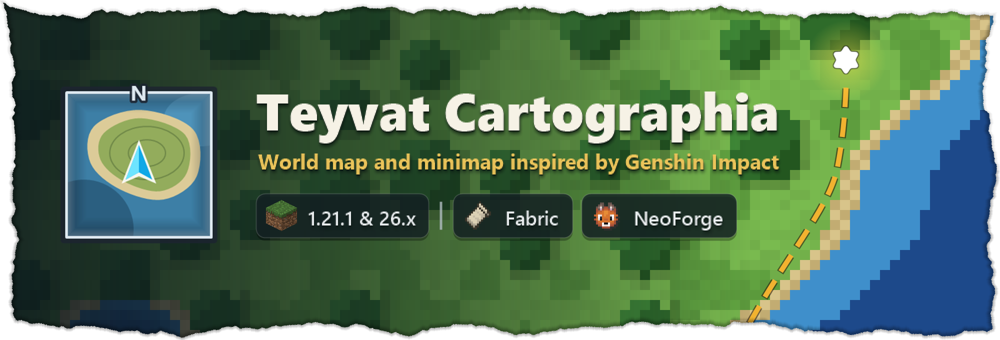
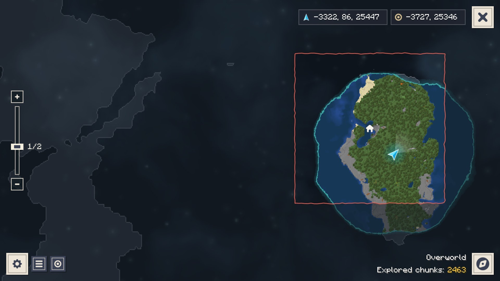
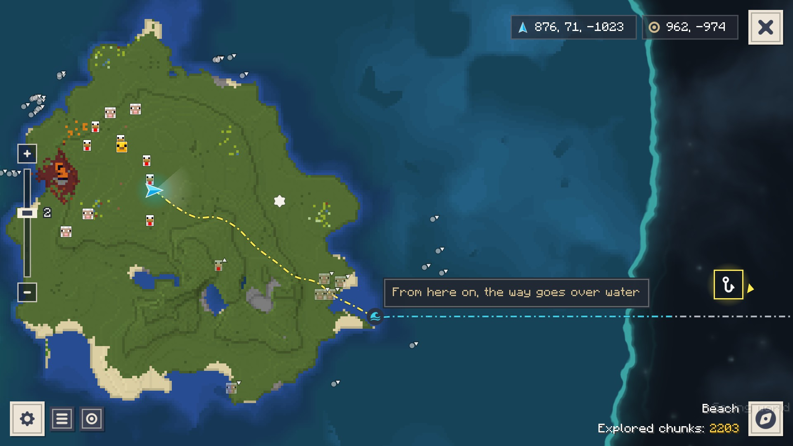
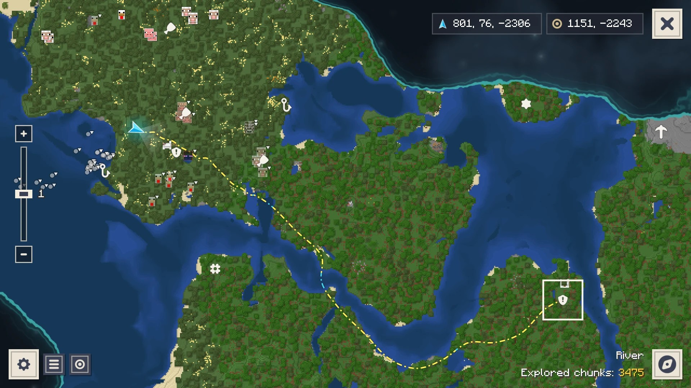
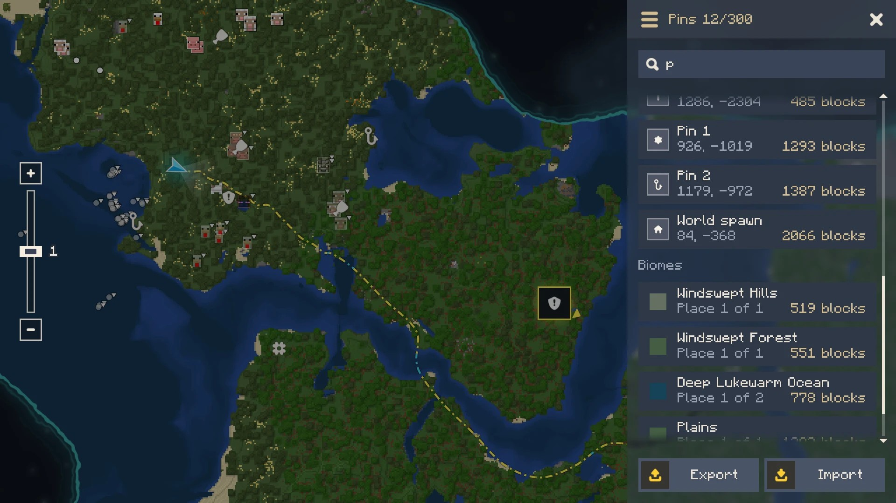
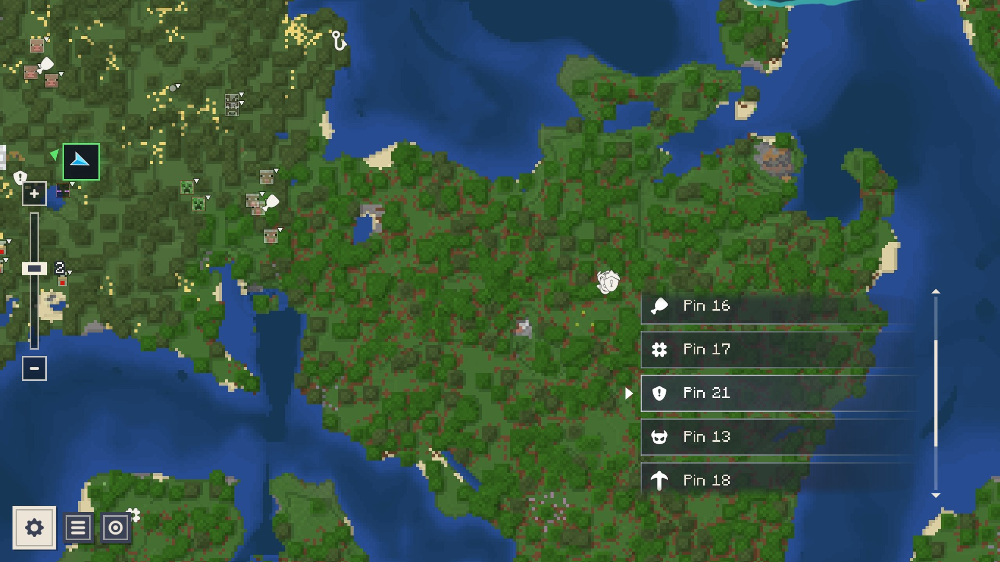
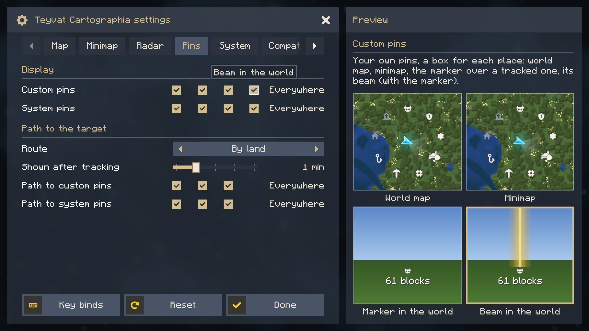
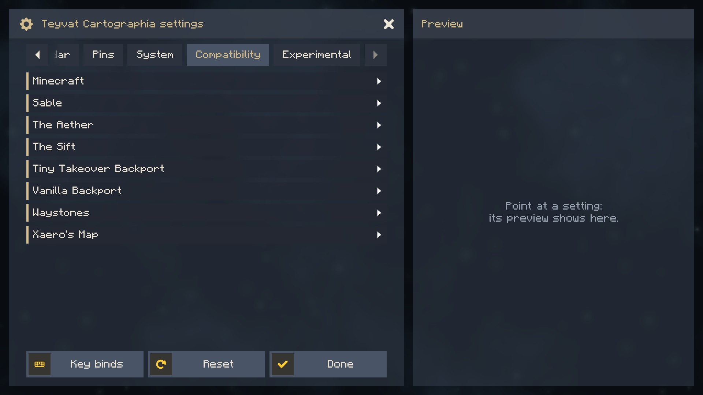
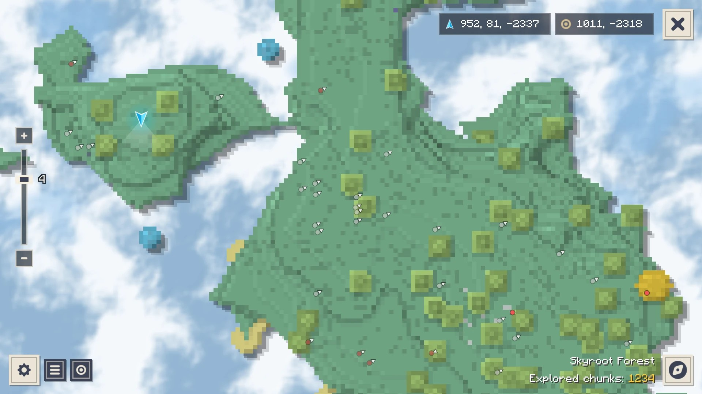
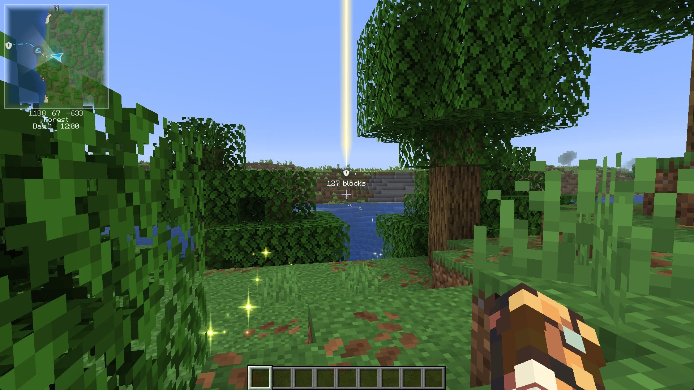

  

  
  
  
  
  

  <b>A world map and minimap in the spirit of Genshin Impact.</b> 
  Explore, and the land you see is painted onto the map. Everything else stays under the Fog of War.

  
  
  

  

<h2 id="features">✨ Features</h2>

- **World map** (**M**): the land you explored, in the colours of its blocks, with shading and water depth. Pan, zoom from 1/32 to 32, search pins and biomes with **Ctrl+F**.
- **Minimap**: square or round, north up or turning with you, with coordinates, biome and a clock.
- **Pins**: seven types, up to 300 per world. Right-click the map to place one, or press **B** where you stand.
- **Tracking**: a golden beam of light over the pin, sparkles on the ground and a line on both maps that walks you there, around water and mountains. Or by boat, or straight through the air for elytra.
- **Caves**: underground, the map switches to the layer you are in.
- **Radar**: other players as arrows or their skins' heads, mobs as dots or their faces, on the minimap and the world map, by the cave layer you look at. On servers only players, unless you allow mobs.
- **Every dimension** gets its own map, The Nether and The End their own fog.
- **Settings** with a live preview of whatever you point at; pick where each kind of pin and path shows, box by box. English and Russian.
- **Experimental**, off by default: Far land (the outline of unexplored land from the world's generator), soft animated map edges, the world border on the map.

  
  
  
  
  
  
  
  

<h2 id="installation">📥 Installation</h2>

| Minecraft | Loader | You also need |
|---|---|---|
| 1.21.1, 26.1.2, 26.2, 26.3 | [Fabric](https://github.com/FabricMC/fabric-loader) | [Fabric API](https://modrinth.com/mod/fabric-api) and [Actually Amazing Config Screen](https://modrinth.com/mod/actually-amazing-config-screen) |
| 1.21.1, 26.1.2, 26.2, 26.3 | [NeoForge](https://github.com/neoforged/NeoForge) | [Actually Amazing Config Screen](https://modrinth.com/mod/actually-amazing-config-screen) |

Download the file for your game and loader (`+mc1.21.1-fabric`, `+mc26.3-neoforge` and so on) and Actually Amazing Config Screen for the same game and loader (its settings screen; Prism Launcher, the Modrinth App and the CurseForge App offer it by themselves), put both into `mods/` and press **M** in a world. The mod is client-side only: it works on any server, vanilla or modded, and the server does not need it.

<h2 id="connector">🔌 Sinytra Connector</h2>

On NeoForge, take the NeoForge file. The Fabric file runs there too, through [Sinytra Connector](https://modrinth.com/mod/connector) with [Forgified Fabric API](https://modrinth.com/mod/forgified-fabric-api) and the Fabric file of Actually Amazing Config Screen (checked on 1.21.1, 26.1.2 and 26.2); [Connector Extras](https://modrinth.com/mod/connector-extras) adds its settings button to NeoForge's mod list.

<h2 id="controls">🎮 Controls</h2>

| Key | What it does |
|---|---|
| **M** | World map (**Esc** or **M** closes it) |
| **N** / **=** / **-** | Minimap on or off, zoom in, zoom out |
| **B** | New pin where you stand |
| **V** | Show the tracked pin and its path again |
| **Z** | Stop tracking |
| On the map | Drag to pan, wheel to zoom, right-click for a new pin, **Ctrl+F** to search, **Space** to come back to you |

Every key can be changed in the game's controls.

<h2 id="compatibility">🧩 Works with</h2>

Blocks of any mod are drawn in the colours of their textures, so most mods just work. Some get a little more:
[Waystones](https://modrinth.com/mod/waystones) (its stones on the map, trackable),
[Xaero's Minimap](https://modrinth.com/mod/xaeros-minimap) (import its waypoints) and
[Xaero's World Map](https://modrinth.com/mod/xaeros-world-map) (import the explored map),
[The Aether](https://modrinth.com/mod/aether) and [Mielon's The Sift](https://modrinth.com/mod/mielons-the-sift) (their own fog),
[Sable](https://modrinth.com/mod/sable) (its ships on the radar, 1.21.1),
[Vanilla Backport](https://modrinth.com/mod/vanillabackport) and [Tiny Takeover Backport](https://modrinth.com/mod/tiny-takeover-backport) (their mobs' faces on the radar, 1.21.1),
[Sodium](https://modrinth.com/mod/sodium), [Iris](https://modrinth.com/mod/iris),
[VulkanMod](https://modrinth.com/mod/vulkanmod) and [Mod Menu](https://modrinth.com/mod/modmenu).

The mod costs at most a few percent of your frame rate: the minimap is redrawn only when it changes, and the map is made on background threads.

<h2 id="faq">❓ Questions</h2>

<b>Does it show the land I have not visited?</b>

No, that is the point: you map the world by exploring it. Far land (Settings > Experimental, single player) can show the outline of unexplored land if you want it.

<b>Where is my map saved?</b>

In `teyvatcartographia/` of your game folder, one map per world or server and per dimension. Pins are in `markers.json` there. They can also be exported to a file from the pin list.

<b>Can I make my own theme?</b>

Yes, as a resource pack: colours, icons and the fog live in `assets/teyvatcartographia/themes/<id>/`. Copy the built-in `default` theme from the mod's file and change what you like.

<h2 id="links">🔗 Links</h2>

- [Report a bug or suggest an idea](https://github.com/Tapacywka/teyvat-cartographia/issues/new/choose) (please attach `logs/latest.log`)
- [Changelog](https://modrinth.com/mod/teyvat-cartographia/changelog)
- [Source code](https://github.com/Tapacywka/teyvat-cartographia): `./gradlew build` (branch `main` for 1.21.1, `mc26` for 26.x)

MIT License. Icons from Game Icon Pack by Nieobie (CC0). The settings screen is made with [Actually Amazing Config Screen](https://modrinth.com/mod/actually-amazing-config-screen). A fan-made mod, not affiliated with HoYoverse; no Genshin Impact assets.
